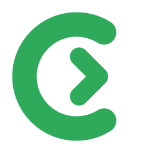

<p align="center"><a href="CONTRIBUTING.md">English</a> · <strong>Français</strong></p>

<p align="center"></p>

<h1 align="center">Contribuer à Clearway</h1>

<p align="center">Les signalements de bugs, les idées et les pull requests sont les bienvenus.</p>

## Avant de commencer

- Pour tout ce qui dépasse une petite correction, ouvrez d'abord une issue pour s'accorder sur l'approche.
- Clearway vise Windows 10/11, avec ou sans WSL. Le code, les identifiants et les sujets de commit sont en anglais ; la
  documentation existe en anglais (par défaut) et en français ; les messages affichés passent par
  `tr!("english", "français")`.

## Compilation et tests

```sh
cargo test                                                   # unitaires + intégration (serveur Linux sur socket Unix)
cargo clippy --all-targets -- -D warnings
cargo zigbuild --release --target x86_64-pc-windows-gnu --bin clearway   # clearway.exe (il faut cargo-zigbuild)
```

Chaque pull request lance les tests et `clippy` sous Linux, puis `clippy` et une compilation release sous Windows (GitHub Actions). Pour une première
contribution, le mainteneur déclenche ces vérifications après un premier examen des modifications.

## Pull requests

Pour l'interface Windows, suivez les [références visuelles validées](docs/design/README.fr.md) et le thème commun dans
`src/visual.rs`. L'application et l'installateur partagent la même palette et les mêmes polices embarquées.

- Un sujet par pull request, avec des tests pour ce qui change.
- `main` ne change que par des pull requests. Le mainteneur relit chacune et l'essaie sur un vrai Windows, avec et sans
  WSL, avant de la fusionner ; cela peut prendre du temps.
- Clearway a une seule version : `Cargo.toml`, `Cargo.lock` et les deux manifestes de plugin
  (`plugins/clearway/.claude-plugin/` et `.codex-plugin/`) changent ensemble à chaque version, même quand le plugin
  lui-même n'a pas changé.
- Un changement de documentation se fait dans les deux langues (`README.md` et `README.fr.md`, `CONTRIBUTING.md` et
  `CONTRIBUTING.fr.md`).

## Versions

Seul le mainteneur publie les versions. Le `SHA256SUMS` de chaque version est signé par la clé Ed25519 du mainteneur, et
Clearway refuse une mise à jour dont la signature ne correspond pas à la clé qu'il embarque. Un changement fusionné
n'arrive donc chez les utilisateurs qu'avec la version signée suivante.

En contribuant, vous acceptez que votre contribution soit publiée sous la licence MIT de ce projet.
