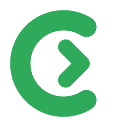

<p align="center"></p>

<h1 align="center">Contributing to Clearway</h1>

<p align="center">Bug reports, ideas and pull requests are welcome.</p>

## Before you start

- For anything larger than a small fix, open an issue first so that we agree on the approach.
- Clearway targets Windows 10/11, with or without WSL. Code, identifiers, docs and commit subjects are in English;
  user-facing messages go through `tr!("english", "français")`.

## Build and test

```sh
cargo test                                                   # unit + integration (Linux server on a Unix socket)
cargo clippy --all-targets -- -D warnings
cargo zigbuild --release --target x86_64-pc-windows-gnu --bin clearway   # clearway.exe (needs cargo-zigbuild)
```

Every pull request runs the same tests and clippy on Linux and Windows (GitHub Actions). For a first-time contributor,
the maintainer starts these runs after a first look at the change.

## Pull requests

- One topic per pull request, with tests for what changes.
- `main` only changes through pull requests. The maintainer reviews each one and tests it on a real Windows machine,
  with and without WSL, before merging; this can take a while.
- Clearway has one version: `Cargo.toml`, `Cargo.lock` and both plugin manifests (`plugins/clearway/.claude-plugin/`
  and `.codex-plugin/`) move together at each release, even when the plugin itself did not change.

## Releases

Only the maintainer publishes releases. Each release's `SHA256SUMS` is signed with the maintainer's Ed25519 key, and
Clearway refuses an update whose signature does not match the key built into it. A merged change therefore reaches
users only in the next signed release.

By contributing, you agree that your contribution is licensed under the MIT License of this project.
