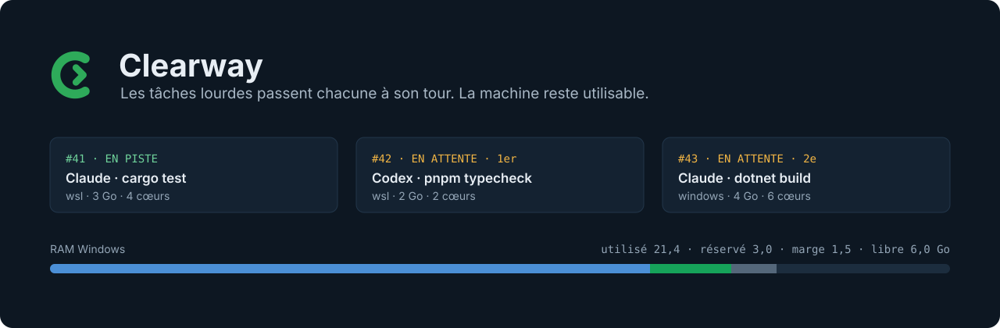

<p align="center"><a href="README.md">English</a> · <strong>Français</strong></p>

<p align="center">
  
</p>

<p align="center">
  <a href="https://github.com/AW-HTK/clearway/releases/latest"></a>
  <a href="https://github.com/AW-HTK/clearway/actions/workflows/ci.yml"></a>
  
  <a href="LICENSE"></a>
</p>

Plusieurs sessions de programmation assistée par IA sur un même PC lancent chacune un build, une suite de tests ou
un modèle local au même moment, et la machine se fige. **Clearway** est une petite file d'attente qui vit à côté de
l'horloge : avant une tâche lourde, la session demande un créneau, attend son tour, lance sa tâche, puis libère le
créneau. Une garde refuse les commandes lourdes lancées sans créneau.

## Comment ça marche

| 1 · Demander | 2 · Attendre | 3 · En piste |
| --- | --- | --- |
| La session demande un créneau : `request_clearance("cargo test", ram="3G", cpu=4)` | Clearway attend qu'il y ait la place : RAM et CPU mesurés sous Windows et dans WSL, moins ce que les tickets actifs vont encore consommer, moins une marge de sécurité. | La session lance sa tâche, puis `release(ticket, code)`. Le ticket suivant passe. |

Les créneaux sont accordés dans l'ordre d'arrivée ; une petite tâche qui finit avant que la tête de file puisse partir
peut passer devant. `clearway.exe` tourne sous Windows (icône près de l'horloge et fenêtre) ; les sessions le joignent
par le serveur MCP `clearway`, ou par la commande `clearway` dans WSL. Les messages sont en français ou en anglais.

## Installation

1. Téléchargez **`clearway-setup.exe`** depuis la [dernière version](https://github.com/AW-HTK/clearway/releases/latest).
2. Lancez-le. Il trouve vos distributions WSL, Claude Code et Codex (en ligne de commande et applications de bureau),
   montre ce qu'il va faire et demande une seule fois. Tout s'installe pour votre compte, sans droits d'administrateur.
3. Relancez vos sessions Claude Code et Codex. Le bouton **Vérifier** de la dernière page contrôle chaque ligne ; dans
   Codex, approuvez une fois la garde Clearway avec `/hooks` (dans l'application Codex : Paramètres › Hooks).

Relancez le setup pour mettre à jour ou réparer, ou pour désinstaller (aussi depuis les **Applications installées** de
Windows).

## Agents pris en charge

| Agent | File (outils MCP) | Garde | État |
| --- | --- | --- | --- |
| Claude Code — CLI et application de bureau | ✓ | hook PreToolUse | Pris en charge |
| Codex — CLI et application de bureau | ✓ | hook PreToolUse, approuvé dans `/hooks` | Pris en charge |
| GitHub Copilot, Cursor, Google Antigravity, Gemini, OpenCode | — | — | Prévu pour la 0.2.0 |

## La garde

```text
$ cargo build --release
Blocked by hook
  Clearway : `cargo build` est une commande lourde. Demande d'abord un créneau avec
  request_clearance, lance la commande au feu vert, puis appelle release.
```

Les builds, suites de tests, vérifications de types, rendus, builds Docker et modèles locaux sont lourds ; tout le
reste passe librement. Si Clearway ne répond pas en 2 secondes, la garde laisse passer la commande : elle ne bloque
jamais une session. `CLEARWAY_HOOK=off` la désactive.

## Des mises à jour de confiance

Rien ne se met à jour tout seul. Le menu de l'icône propose **Chercher les mises à jour** (ou `update.check = "daily"`
dans `config.toml`). Clearway télécharge `clearway-setup.exe`, vérifie que `SHA256SUMS` est signé par la clé Ed25519 du
mainteneur et que le setup lui correspond, puis ouvre le setup, qui montre ce qu'il change et demande d'abord. Après le
changement, l'installateur vérifie que la nouvelle version répond, et sinon remet la précédente.

---

<details>
<summary><strong>Ce que le setup installe</strong></summary>

- `clearway.exe` dans `%LOCALAPPDATA%\Programs\clearway`, dans le `PATH` de l'utilisateur, lancé à l'ouverture de
  session par la tâche `Clearway` ;
- le client `clearway` dans `~/.local/bin` de chaque distribution WSL démarrée (une distribution arrêtée est laissée
  telle quelle : démarrez-la et relancez le setup) ;
- le plugin Clearway dans chaque Claude Code et Codex trouvé, y compris les applications de bureau Claude et Codex
  sous Windows, qui partagent la configuration des outils en ligne de commande.

La désinstallation retire les plugins, les clients WSL, la tâche, l'entrée du `PATH` et le dossier, et garde les
réglages et le journal sauf demande contraire ; `clearway-setup.exe --uninstall --yes` le fait sans fenêtre.

La version publiée ne contient que `clearway-setup.exe` et ses empreintes signées (`SHA256SUMS`, `SHA256SUMS.sig`) ;
le setup embarque tout le reste. `windows/install.ps1`, `windows/uninstall.ps1` et `install.sh` sont ce qu'il lance ;
ils installent aussi depuis un dossier `dist/` local (`CLEARWAY_SOURCE=<dist>`).

</details>

<details>
<summary><strong>Plugins (Claude Code et Codex)</strong></summary>

Ce dépôt sert de catalogue de plugins (marketplace) pour les deux. Le plugin (`plugins/clearway/`) apporte le
serveur MCP `clearway` (`clearway mcp`, donc `clearway` ou `clearway.exe` doit être dans le `PATH`), la compétence
(skill) `heavy-tasks`, un hook PreToolUse (`clearway hook`) et, pour Claude Code, l'agent `clearance-waiter`. Sans le
setup :

```sh
claude plugin marketplace add AW-HTK/clearway && claude plugin install clearway@clearway --scope user
codex plugin marketplace add AW-HTK/clearway && codex plugin add clearway@clearway
```

Dans Claude Code, les outils s'appellent `mcp__plugin_clearway_clearway__<outil>`. Codex lit le même
`.claude-plugin/marketplace.json` et le `.codex-plugin/plugin.json` du plugin. Dans le bac à sable de Codex, aucun
programme Windows ne peut démarrer : Codex passe donc uniquement par les outils MCP.

</details>

<details>
<summary><strong>Commandes</strong></summary>

- Serveur (Windows) : `clearway.exe [serve] [--dir <chemin>] [--test | --test-icon]`. `--test` : rien à l'écran.
- Relais : `clearway.exe relay [--pipe <nom>]` (stdin/stdout ↔ tube nommé ; code 69 si le serveur est absent, 74 si
  le tube se ferme).
- Client (WSL) : `clearway run [--side wsl|windows] [--ram 3G] [--cpu 4] [--duration 15m] [--max 9m] "description" --
  commande…`, `clearway request`, `wait`, `extend`, `release`, `cancel`, `status`. Codes de sortie : 0, 1 ticket sorti
  de la file, 2 erreur, 3 refus, 75 toujours en attente après `--max` ou feu vert repris avant l'accusé de réception
  (relancer la même commande garde la place), 130 interrompu.
- Garde : `clearway hook` / `clearway.exe hook` (événement PreToolUse sur stdin, refus sur stdout).
- Variables du client : `CLEARWAY_EXE`, `CLEARWAY_PIPE`, `CLEARWAY_DIR` (dossier d'état vu depuis WSL, pour le fichier
  de maintenance), `CLEARWAY_LAUNCH_ARGS`, `CLEARWAY_SESSION`, `CLEARWAY_LANG`.

</details>

<details>
<summary><strong>Fichiers et réglages</strong></summary>

- Exe : `%LOCALAPPDATA%\Programs\clearway\clearway.exe` ; tâche planifiée `Clearway` ; installé et mis à jour par
  `windows/install.ps1` (ou `clearway-setup.exe`, qui le lance).
- État : `%LOCALAPPDATA%\clearway\` (`state.json`, `clearway.log`, `config.toml` écrit au premier démarrage).
- `config.toml` : `pipe`, `legacy_pipe`, `language` (`en`, `fr`, `auto`), réserves, marges, besoins par défaut, délais,
  seuils de remplissage et de swap ; le fichier écrit au premier démarrage documente chaque clé.

</details>

<details>
<summary><strong>Protocole</strong></summary>

- Tube nommé `\\.\pipe\clearway` (ACL : utilisateur courant et SYSTEM, clients distants refusés) ; un socket Unix
  `$XDG_RUNTIME_DIR/clearway-<pipe>.sock` hors de Windows. Une requête JSON par ligne
  (`{"method","path","params","body"}`), une réponse par ligne (`{"code","body"}`).
- Routes : `POST /tickets`, `GET /tickets/{n}/wait` (`known`, `timeout_s`, `ack`), `POST /tickets/{n}/presence`,
  `/extend`, `/release`, `/ack`, `DELETE /tickets/{n}`, `GET /status`, `POST /freeze`, `/window`, `/quit`, `/link`,
  `/link/heartbeat`.
- Multiplexage : une requête avec un `"id"` tourne dans son propre fil et sa réponse porte le même `id`, dans n'importe
  quel ordre ; sans `id`, les requêtes sont servies l'une après l'autre. Le relais copie dans les deux sens à la fois
  (E/S asynchrones sous Windows) ; à la fin de stdin, il livre encore les réponses aux requêtes sans `id`.
- Accusé du feu vert : `clearway wait` et `clearway run` envoient `ack=1`, puis `POST /tickets/{n}/ack` une fois le feu
  vert réellement livré ; sans accusé dans `delay.recall`, le feu vert est repris.
- Liaisons : `POST /link` (`identity`, `session`, `client`, `measures`) relie la connexion à une session (processus
  MCP) ; `POST /link/heartbeat` porte les mesures WSL et la présence de ses tickets actifs. Quand la connexion se ferme
  (ou après un redémarrage du serveur), ses tickets attendent `delay.resume` une liaison de même `identity` (les actifs
  restent réservés sans geler la file, ceux en attente sont sautés), puis sont retirés.

</details>

<details>
<summary><strong>Compatibilité avec la version d'avant Clearway</strong></summary>

- Le serveur écoute aussi l'ancien tube `orchestrateur` (`legacy_pipe = true`), accepte l'ancien dialecte français
  (`methode`, `chemin`, routes et clés françaises) et y répond dans ce dialecte.
- Appelé `charge` (lien vers `clearway`), le client garde les anciennes sous-commandes (`demande`, `attend`, `fin`,
  `annule`, `prolonge`, `statut`), les anciennes variables `CHARGE_*` et les messages en français ; appelé
  `orchestrateur.exe`, l'exe accepte toujours `relais --tube`.
- Premier démarrage : `%LOCALAPPDATA%\orchestrateur\` est copié dans `%LOCALAPPDATA%\clearway\` (ancien dossier gardé,
  avec `MIGRATED-TO-CLEARWAY.txt`) ; `etat.json` devient `state.json`, un `config.toml` en français est réécrit en
  anglais (copie `config.toml.before-clearway`).

</details>

<details>
<summary><strong>Compilation et tests</strong></summary>

`scripts/build-release.sh` construit tous les fichiers de la version dans `dist/` (il faut cargo-zigbuild, les cibles
`x86_64-pc-windows-gnu` et `x86_64-unknown-linux-musl`, et la graine de signature dans `CLEARWAY_RELEASE_SIGNING_KEY` ;
`examples/sign_release.rs` contient les commandes du mainteneur). Il refuse une version dont les manifestes de plugin ne
portent pas la version de `Cargo.toml`. Pour le développement :

```sh
export PATH=$HOME/.cargo/bin:$(echo ~/.local/share/uv/tools/cargo-zigbuild/lib/python*/site-packages/ziglang):$PATH
cargo build --release -j 4 --bin clearway                                          # client Linux (et serveur de test)
cargo zigbuild --release -j 4 --target x86_64-pc-windows-gnu --bin clearway        # clearway.exe
cargo test -j 4    # unitaires + intégration (serveur Linux sur socket Unix, mesures simulées)
```

Sur un vrai Windows (instance de test, rien à l'écran) : `tests/windows-api.ps1` (l'exe seul, client PowerShell sur le
tube), `tests/windows-e2e.sh` (de bout en bout depuis WSL avec le vrai client et le relais), `tests/window-capture.ps1
<sortie.png>` (capture de la fenêtre hors écran).

</details>

<p align="center"><sub>MIT · <a href="CONTRIBUTING.fr.md">Contribuer</a> · <a href="https://github.com/AW-HTK/clearway/releases">Versions</a></sub></p>
