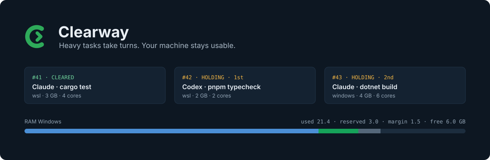

<p align="center"><strong>English</strong> · <a href="README.fr.md">Français</a></p>

<p align="center">
  
</p>

<p align="center">
  <a href="https://github.com/AW-HTK/clearway/releases/latest"></a>
  <a href="https://github.com/AW-HTK/clearway/actions/workflows/ci.yml"></a>
  
  <a href="LICENSE"></a>
</p>

Several AI coding sessions on one PC each start a build, a test suite or a local model at the same moment, and the
machine freezes. **Clearway** is a small queue that lives next to the clock: before a heavy task, a session asks for a
slot, waits for its turn, runs, then releases. A guard refuses heavy commands started without a slot.

## How it works

| 1 · Ask | 2 · Hold | 3 · Cleared |
| --- | --- | --- |
| The session requests a slot: `request_clearance("cargo test", ram="3G", cpu=4)` | Clearway waits for room: RAM and CPU measured on Windows and inside WSL, minus what active tickets still need, minus a safety margin. | The session runs its task, then `release(ticket, code)`. The next ticket goes. |

Slots are granted in arrival order; a small task that ends before the head of the queue could start may go first.
`clearway.exe` runs on Windows (tray icon and window); sessions reach it through the `clearway` MCP server, or the
`clearway` command in WSL. Messages are in English or French.

## Install

1. Download **`clearway-setup.exe`** from the [latest release](https://github.com/AW-HTK/clearway/releases/latest).
2. Run it. It finds your WSL distributions, Claude Code and Codex (command line and desktop apps), shows what it will
   do and asks once. Everything installs for your account, without administrator rights.
3. Restart your Claude Code and Codex sessions. The last page's **Verify** button checks each line; in Codex, approve
   the Clearway hook once with `/hooks` (in the Codex app: Settings › Hooks).

Run the setup again to update or repair, or to uninstall (also in Windows **Installed apps**).

## Supported agents

| Agent | Queue (MCP tools) | Guard | Status |
| --- | --- | --- | --- |
| Claude Code — CLI and desktop app | ✓ | PreToolUse hook | Supported |
| Codex — CLI and desktop app | ✓ | PreToolUse hook, approved in `/hooks` | Supported |
| GitHub Copilot, Cursor, Google Antigravity, Gemini, OpenCode | — | — | Planned for 0.2.0 |

## The guard

```text
$ cargo build --release
Blocked by hook
  Clearway: `cargo build` is a heavy command. First ask for a slot with
  request_clearance, run the command once cleared, then call release.
```

Builds, test suites, type checks, renders, docker builds and local models count as heavy; everything else runs freely.
If Clearway does not answer within 2 seconds, the guard lets the command through: it never locks a session out.
`CLEARWAY_HOOK=off` turns it off.

## Updates you can trust

Nothing updates by itself. The tray menu has **Check for updates** (or set `update.check = "daily"` in
`config.toml`). Clearway downloads `clearway-setup.exe`, checks that `SHA256SUMS` is signed with the maintainer's
Ed25519 key and that the setup matches it, then opens the setup, which shows what it changes and asks first. After the
switch, the installer checks that the new version answers, and otherwise puts the previous one back.

---

<details>
<summary><strong>What the setup installs</strong></summary>

- `clearway.exe` in `%LOCALAPPDATA%\Programs\clearway`, on the user `PATH`, started at logon by the `Clearway` task;
- the `clearway` client in `~/.local/bin` of each running WSL distribution (a stopped one is left alone: start it and
  run the setup again);
- the Clearway plugin in each Claude Code and Codex it found, including the Claude and Codex desktop apps on Windows,
  which share the configuration of the command line tools.

Uninstalling removes the plugins, the WSL clients, the task, the `PATH` entry and the folder, and keeps the settings
and the log unless asked; `clearway-setup.exe --uninstall --yes` does it without the window.

The release only carries `clearway-setup.exe` and its signed checksums (`SHA256SUMS`, `SHA256SUMS.sig`); the setup
embeds everything else. `windows/install.ps1`, `windows/uninstall.ps1` and `install.sh` are what it runs; they also
install from a local `dist/` folder (`CLEARWAY_SOURCE=<dist>`).

</details>

<details>
<summary><strong>Plugins (Claude Code and Codex)</strong></summary>

This repository is a plugin marketplace for both. The plugin (`plugins/clearway/`) brings the `clearway` MCP server
(`clearway mcp`, so `clearway` or `clearway.exe` must be on the `PATH`), the `heavy-tasks` skill, a PreToolUse hook
(`clearway hook`) and, for Claude Code, the `clearance-waiter` agent. Without the setup:

```sh
claude plugin marketplace add AW-HTK/clearway && claude plugin install clearway@clearway --scope user
codex plugin marketplace add AW-HTK/clearway && codex plugin add clearway@clearway
```

In Claude Code the tools are named `mcp__plugin_clearway_clearway__<tool>`. Codex reads the same
`.claude-plugin/marketplace.json` and the plugin's `.codex-plugin/plugin.json`. Inside the Codex sandbox, Windows
programs cannot start, so Codex uses the MCP tools only.

</details>

<details>
<summary><strong>Commands</strong></summary>

- Server (Windows): `clearway.exe [serve] [--dir <path>] [--test | --test-icon]`. `--test`: nothing on screen.
- Relay: `clearway.exe relay [--pipe <name>]` (stdin/stdout ↔ named pipe; exit 69 if the server is absent, 74 if
  the pipe closes).
- Client (WSL): `clearway run [--side wsl|windows] [--ram 3G] [--cpu 4] [--duration 15m] [--max 9m] "description" --
  command…`, `clearway request`, `wait`, `extend`, `release`, `cancel`, `status`. Exit codes: 0, 1 ticket out of the
  queue, 2 error, 3 refused, 75 still waiting after `--max` or clearance taken back before the acknowledgement (rerun
  the same command to keep the place), 130 interrupted.
- Hook: `clearway hook` / `clearway.exe hook` (PreToolUse event on stdin, refusal on stdout).
- Client variables: `CLEARWAY_EXE`, `CLEARWAY_PIPE`, `CLEARWAY_DIR` (state folder seen from WSL, for the maintenance
  file), `CLEARWAY_LAUNCH_ARGS`, `CLEARWAY_SESSION`, `CLEARWAY_LANG`.

</details>

<details>
<summary><strong>Files and settings</strong></summary>

- Exe: `%LOCALAPPDATA%\Programs\clearway\clearway.exe`; scheduled task `Clearway`; installed and updated by
  `windows/install.ps1` (or `clearway-setup.exe`, which runs it).
- State: `%LOCALAPPDATA%\clearway\` (`state.json`, `clearway.log`, `config.toml` written at first start).
- `config.toml`: `pipe`, `legacy_pipe`, `language` (`en`, `fr`, `auto`), reserves, margins, default needs, delays,
  backfill and swap thresholds; the file written at first start documents every key.

</details>

<details>
<summary><strong>Protocol</strong></summary>

- Named pipe `\\.\pipe\clearway` (ACL: current user and SYSTEM, remote clients refused); a Unix socket
  `$XDG_RUNTIME_DIR/clearway-<pipe>.sock` outside Windows. One JSON request per line
  (`{"method","path","params","body"}`), one response per line (`{"code","body"}`).
- Routes: `POST /tickets`, `GET /tickets/{n}/wait` (`known`, `timeout_s`, `ack`), `POST /tickets/{n}/presence`,
  `/extend`, `/release`, `/ack`, `DELETE /tickets/{n}`, `GET /status`, `POST /freeze`, `/window`, `/quit`, `/link`,
  `/link/heartbeat`.
- Multiplexing: a request with an `"id"` runs on its own thread and its response carries the same `id`, in any order;
  without `id`, requests are served one after the other. The relay copies both ways at once (overlapped I/O on
  Windows); at the end of stdin it still delivers the responses to requests without `id`.
- Clearance acknowledgement: `clearway wait` and `clearway run` send `ack=1`, then `POST /tickets/{n}/ack` once the
  clearance has really been delivered; without it within `delay.recall`, the clearance is taken back.
- Links: `POST /link` (`identity`, `session`, `client`, `measures`) ties the connection to a session (MCP process);
  `POST /link/heartbeat` carries the WSL measures and the presence of its active tickets. When the connection closes
  (or after a server restart), its tickets wait `delay.resume` for a link with the same `identity` (active ones stay
  reserved without freezing the queue, waiting ones are skipped), then are removed.

</details>

<details>
<summary><strong>Compatibility with the pre-Clearway version</strong></summary>

- The server also listens on the old pipe `orchestrateur` (`legacy_pipe = true`), accepts the old French dialect
  (`methode`, `chemin`, French routes and keys) and answers it in that dialect.
- Called as `charge` (link to `clearway`), the client keeps the old subcommands (`demande`, `attend`, `fin`, `annule`,
  `prolonge`, `statut`), the old `CHARGE_*` variables and French messages; called as `orchestrateur.exe`, the exe still
  accepts `relais --tube`.
- First start: `%LOCALAPPDATA%\orchestrateur\` is copied to `%LOCALAPPDATA%\clearway\` (old folder kept, with
  `MIGRATED-TO-CLEARWAY.txt`); `etat.json` becomes `state.json`, a French `config.toml` is rewritten in English (backup
  `config.toml.before-clearway`).

</details>

<details>
<summary><strong>Build and tests</strong></summary>

`scripts/build-release.sh` builds every release file into `dist/` (needs cargo-zigbuild, the targets
`x86_64-pc-windows-gnu` and `x86_64-unknown-linux-musl`, and the signing seed in `CLEARWAY_RELEASE_SIGNING_KEY`;
`examples/sign_release.rs` holds the maintainer's commands). It refuses a release whose plugin manifests do not carry
the version of `Cargo.toml`. For development:

```sh
export PATH=$HOME/.cargo/bin:$(echo ~/.local/share/uv/tools/cargo-zigbuild/lib/python*/site-packages/ziglang):$PATH
cargo build --release -j 4 --bin clearway                                          # Linux client (and test server)
cargo zigbuild --release -j 4 --target x86_64-pc-windows-gnu --bin clearway        # clearway.exe
cargo test -j 4    # unit + integration (Linux build of the server on a Unix socket, simulated measures)
```

On real Windows (test instance, nothing on screen): `tests/windows-api.ps1` (the exe alone, PowerShell client on the
pipe), `tests/windows-e2e.sh` (end to end from WSL with the real client and relay), `tests/window-capture.ps1
<out.png>` (capture of the off-screen window).

</details>

<p align="center"><sub>MIT · <a href="CONTRIBUTING.md">Contributing</a> · <a href="https://github.com/AW-HTK/clearway/releases">Releases</a></sub></p>
